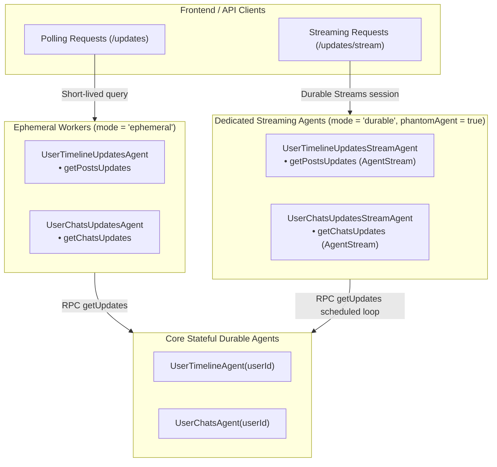

# Feature Plan: Specific Streaming Agents for Timeline and Chat Updates

- **Feature ID / Slug**: `specific-streaming-agents`
- **Date**: 2026-10-27
- **Status**: Completed <!-- Draft | Approved | In Progress | Completed -->

---

## 1. Overview & Goals

Currently, `UserTimelineUpdatesAgent` and `UserChatsUpdatesAgent` are defined as ephemeral agents (`mode: "ephemeral"`). They bundle both polling endpoints (`getPostsUpdates`, `getChatsUpdates`) and streaming endpoints (`getPostsUpdatesStream`, `getChatsUpdatesStream`).

Ephemeral workers obtain a fresh instance per invocation, lack persistent durable state, and cannot suspend durably across long delays (subject to ephemeral sleep limits). In Golem's Durable Streams protocol, an HTTP client establishes a stream session via `PUT` and subsequently tails/reads SSE stream slots (`/invocations/{session}/streams/$result`). Because ephemeral workers discard state and cannot reliably maintain long-lived background producer loops (`Stream.fromEffectSchedule` or delayed polling cycles), stream-bearing endpoints fail or behave unpredictably under ephemeral execution.

### Goals

1. **Introduce Dedicated Streaming Agents**:
   - Create `UserTimelineUpdatesStreamAgent` in [`src/user-timeline/index.ts`](file:///Users/coon/workspace-zv/git/golem-social-net-effect/src/user-timeline/index.ts) for timeline post update streams.
   - Create `UserChatsUpdatesStreamAgent` in [`src/user-chats/index.ts`](file:///Users/coon/workspace-zv/git/golem-social-net-effect/src/user-chats/index.ts) for chat update streams.
2. **Simplified Method Naming**:
   - Inside the streaming agents, drop the redundant `Stream` suffix from method names:
     - `UserTimelineUpdatesStreamAgent.getPostsUpdates` returning `WitTypes.AgentStream(TimelinePostRefSchema)`
     - `UserChatsUpdatesStreamAgent.getChatsUpdates` returning `WitTypes.AgentStream(ChatRefSchema)`
3. **Durable & Concurrent Worker Model**:
   - Configure streaming agents as durable workers with `mode: "durable"`, `id: {}`, and `http: Http.mount("/v1/social-net/users", { phantomAgent: true })`.
   - Each stream connection is routed to a fresh durable phantom agent instance, isolating stream execution across users and multiple tabs without head-of-line blocking.
4. **Preserve Ephemeral Polling Agents**:
   - Keep `UserTimelineUpdatesAgent` and `UserChatsUpdatesAgent` strictly for request-response / long-polling (`getPostsUpdates` and `getChatsUpdates`), removing the streaming methods from them.
5. **Maintain Full API Compatibility**:
   - Keep the existing HTTP URL paths unchanged:
     - `GET /v1/social-net/users/{userId}/timeline/posts/updates/stream?since={since}&iterWaitTime={iterWaitTime}`
     - `GET /v1/social-net/users/{userId}/chats/updates/stream?since={since}&iterWaitTime={iterWaitTime}`
   - Maintain client compatibility with `frontend/src/api.ts` and OpenAPI consumers.
6. **Update Application Manifest**:
   - Register `UserTimelineUpdatesStreamAgent` and `UserChatsUpdatesStreamAgent` in [`golem.yaml`](file:///Users/coon/workspace-zv/git/golem-social-net-effect/golem.yaml) under `httpApi.deployments.local.agents`.
7. **Update Architecture Documentation**:
   - Update [`README.md`](file:///Users/coon/workspace-zv/git/golem-social-net-effect/README.md) to document the new streaming agents and explain real-time synchronization via long-polling vs Durable Streams.

### Non-Goals

- Altering the underlying stream generation logic (`Stream.fromEffectSchedule`).
- Modifying the polling API contracts or changing data schemas (`TimelinePostRefSchema`, `ChatRefSchema`).
- Altering the frontend client implementation.

---

## 2. Architecture & Technical Design

### Agent Separation Architecture



### Key Decisions

1. **Dedicated Agent Types vs Shared Ephemeral Agents**:
   - *Decision*: Separate streaming into `UserTimelineUpdatesStreamAgent` and `UserChatsUpdatesStreamAgent`.
   - *Rationale*: Ephemeral mode cannot support long-lived background sleep loops or durable stream reconnects. Dedicated agents clearly separate the lifecycle of ephemeral request handlers from long-lived durable streaming workers.
2. **Naming Convention**:
   - *Decision*: Agent names are `UserTimelineUpdatesStreamAgent` and `UserChatsUpdatesStreamAgent`. Method names are `getPostsUpdates` and `getChatsUpdates` (dropping the redundant `Stream` suffix since the agent itself is dedicated to streaming).
   - *Rationale*: Clean, idiomatic Effect API design consistent with the Rust implementation.
3. **Durable with `phantomAgent: true`**:
   - *Decision*: Define streaming agents with `mode: "durable"`, `id: {}`, and `http: Http.mount("/v1/social-net/users", { phantomAgent: true })`.
   - *Rationale*: If a streaming agent were a singleton (`id: {}` without phantom), all clients and users would queue behind a single worker thread. By specifying `{ phantomAgent: true }`, each HTTP stream connection is allocated an isolated durable worker instance with its own phantom ID. This allows concurrent streams across users and multiple tabs per user without interference.
4. **HTTP Mount Path Consistency**:
   - *Decision*: Mount at `/v1/social-net/users` with endpoint paths matching the existing routes (`/{userId}/timeline/posts/updates/stream` and `/{userId}/chats/updates/stream`).
   - *Rationale*: Guarantees zero breaking changes for existing HTTP clients.
5. **Registration in `golem.yaml`**:
   - *Decision*: Add `UserTimelineUpdatesStreamAgent` and `UserChatsUpdatesStreamAgent` to `httpApi.deployments.local.agents`.
   - *Rationale*: Required by Golem CLI to expose agent HTTP endpoints through the local gateway.

---

## 3. Proposed Changes & File Impact

| Action     | File Path                                                                                  | Description                                                                                                                                                            |
| :--------- | :----------------------------------------------------------------------------------------- | :--------------------------------------------------------------------------------------------------------------------------------------------------------------------- |
| `[MODIFY]` | [`src/user-timeline/index.ts`](file:///Users/coon/workspace-zv/git/golem-social-net-effect/src/user-timeline/index.ts) | Remove `getPostsUpdatesStream` from `UserTimelineUpdatesAgent`. Define and implement `UserTimelineUpdatesStreamAgent` with `getPostsUpdates`.                        |
| `[MODIFY]` | [`src/user-chats/index.ts`](file:///Users/coon/workspace-zv/git/golem-social-net-effect/src/user-chats/index.ts)       | Remove `getChatsUpdatesStream` from `UserChatsUpdatesAgent`. Define and implement `UserChatsUpdatesStreamAgent` with `getChatsUpdates`.                              |
| `[MODIFY]` | [`golem.yaml`](file:///Users/coon/workspace-zv/git/golem-social-net-effect/golem.yaml)                                   | Add `UserTimelineUpdatesStreamAgent` and `UserChatsUpdatesStreamAgent` under `httpApi.deployments.local.agents`.                                                      |
| `[MODIFY]` | [`README.md`](file:///Users/coon/workspace-zv/git/golem-social-net-effect/README.md)                                       | Document `UserTimelineUpdatesStreamAgent` and `UserChatsUpdatesStreamAgent` under Architecture Components (Streaming Agents) and update Real-time Synchronization.   |

### Detailed Changes

#### [`src/user-timeline/index.ts`](file:///Users/coon/workspace-zv/git/golem-social-net-effect/src/user-timeline/index.ts)
- In `UserTimelineUpdatesAgent`:
  - Remove `getPostsUpdatesStream` method definition from `methods`.
  - Remove `getPostsUpdatesStream` handler from implementation.
- Define and export `UserTimelineUpdatesStreamAgent`:
  ```typescript
  export const UserTimelineUpdatesStreamAgent = defineAgent({
    name: "UserTimelineUpdatesStreamAgent",
    mode: "durable",
    id: {},
    http: Http.mount("/v1/social-net/users", { phantomAgent: true }),
    methods: {
      getPostsUpdates: method({
        input: {
          userId: Schema.String,
          since: Schema.NullOr(Schema.String),
          iterWaitTime: Schema.NullOr(Schema.Number),
        },
        success: WitTypes.AgentStream(TimelinePostRefSchema),
        http: [
          Http.get(
            "/{userId}/timeline/posts/updates/stream?since={since}&iterWaitTime={iterWaitTime}",
            {
              durableStreams: {
                slots: [{ source: "output", slot: "$result", name: "updates" }],
                load: {
                  maxConcurrentReadersPerStream: 8,
                },
              },
            },
          ),
        ],
      }),
    },
  }).implement({
    init: () => Effect.void,
    methods: () => ({
      getPostsUpdates: ({ userId, since, iterWaitTime }) =>
        Effect.gen(function* () {
          const interval = iterWaitTime ?? 1000;
          const initialSince = since ?? getCurrentTimestamp().timestamp;
          const cursorRef = yield* Ref.make(initialSince);

          const pollEffect = Effect.scoped(
            Effect.gen(function* () {
              const currentSince = yield* Ref.get(cursorRef);
              const uAgent = yield* UserTimelineAgent.client.get({ id: userId }).pipe(Effect.orDie);
              const updates = yield* uAgent
                .getUpdates({ updatesSince: { timestamp: currentSince } })
                .pipe(Effect.orDie);

              if (updates && updates.posts.length > 0) {
                const latest = updates.posts.reduce(
                  (max, p) => (p.updatedAt.timestamp > max ? p.updatedAt.timestamp : max),
                  currentSince,
                );
                yield* Ref.set(cursorRef, latest);
                return updates.posts as TimelinePostRef[];
              }
              return [] as TimelinePostRef[];
            }),
          );

          const stream = Stream.fromEffectSchedule(
            pollEffect,
            Schedule.spaced(`${interval} millis`),
          ).pipe(Stream.flatMap((posts: TimelinePostRef[]) => Stream.fromIterable(posts)));

          return stream;
        }),
    }),
  });
  ```

#### [`src/user-chats/index.ts`](file:///Users/coon/workspace-zv/git/golem-social-net-effect/src/user-chats/index.ts)
- In `UserChatsUpdatesAgent`:
  - Remove `getChatsUpdatesStream` method definition from `methods`.
  - Remove `getChatsUpdatesStream` handler from implementation.
- Define and export `UserChatsUpdatesStreamAgent`:
  ```typescript
  export const UserChatsUpdatesStreamAgent = defineAgent({
    name: "UserChatsUpdatesStreamAgent",
    mode: "durable",
    id: {},
    http: Http.mount("/v1/social-net/users", { phantomAgent: true }),
    methods: {
      getChatsUpdates: method({
        input: {
          userId: Schema.String,
          since: Schema.NullOr(Schema.String),
          iterWaitTime: Schema.NullOr(Schema.Number),
        },
        success: WitTypes.AgentStream(ChatRefSchema),
        http: [
          Http.get("/{userId}/chats/updates/stream?since={since}&iterWaitTime={iterWaitTime}", {
            durableStreams: {
              slots: [{ source: "output", slot: "$result", name: "updates" }],
              load: {
                maxConcurrentReadersPerStream: 8,
              },
            },
          }),
        ],
      }),
    },
  }).implement({
    init: () => Effect.void,
    methods: () => ({
      getChatsUpdates: ({ userId, since, iterWaitTime }) =>
        Effect.gen(function* () {
          const interval = iterWaitTime ?? 1000;
          const initialSince = since ?? getCurrentTimestamp().timestamp;
          const cursorRef = yield* Ref.make(initialSince);

          const pollEffect = Effect.scoped(
            Effect.gen(function* () {
              const currentSince = yield* Ref.get(cursorRef);
              const uAgent = yield* UserChatsAgent.client.get({ id: userId }).pipe(Effect.orDie);
              const updates = yield* uAgent
                .getUpdates({ updatesSince: { timestamp: currentSince } })
                .pipe(Effect.orDie);

              if (updates && updates.chats.length > 0) {
                const latest = updates.chats.reduce(
                  (max, c) => (c.updatedAt.timestamp > max ? p.updatedAt.timestamp : max),
                  currentSince,
                );
                yield* Ref.set(cursorRef, latest);
                return updates.chats as ChatRef[];
              }
              return [] as ChatRef[];
            }),
          );

          const stream = Stream.fromEffectSchedule(
            pollEffect,
            Schedule.spaced(`${interval} millis`),
          ).pipe(Stream.flatMap((chats: ChatRef[]) => Stream.fromIterable(chats)));

          return stream;
        }),
    }),
  });
  ```

#### [`golem.yaml`](file:///Users/coon/workspace-zv/git/golem-social-net-effect/golem.yaml)
- Update `httpApi.deployments.local.agents` to include:
  ```yaml
        UserChatsUpdatesStreamAgent: {}
        UserTimelineUpdatesStreamAgent: {}
  ```

#### [`README.md`](file:///Users/coon/workspace-zv/git/golem-social-net-effect/README.md)
- In `### Agents`, add subsection for Streaming Agents:
  ```markdown
  #### Streaming Agents (Durable / Phantom)
  - **User Timeline Updates Stream Agent**: Streams live post updates for a user's timeline using Golem Durable Streams (SSE).
  - **User Chats Updates Stream Agent**: Streams live chat and message updates for a user using Golem Durable Streams (SSE).
  ```
- In `5. Real-time Synchronization`:
  - Document both long-polling (`UserTimelineUpdatesAgent`, `UserChatsUpdatesAgent`) and streaming via Golem Durable Streams (`UserTimelineUpdatesStreamAgent`, `UserChatsUpdatesStreamAgent`).

---

## 4. Verification Plan

### Automated Checks

1. **Code Formatting**:
   ```bash
   npm run format:check
   ```
2. **TypeScript Compilation & Type Check**:
   ```bash
   npm run typecheck
   ```
3. **Linter Verification**:
   ```bash
   npm run lint
   ```
4. **Golem Component Build**:
   ```bash
   npm run build
   ```

### Manual / Integration Verification

1. Verify Golem manifest trace and generated routes:
   - Run `npm run build` and ensure the component compiles and rolls up cleanly into QuickJS WASM.
   - Verify that endpoints `/{userId}/timeline/posts/updates/stream` and `/{userId}/chats/updates/stream` are exported and mapped to the new stream agents.

---

## 5. Risks & Open Questions

- **Risk**: Route collisions between agents mounted at `/v1/social-net/users`.
  - *Mitigation*: Golem HTTP API matches endpoints by specific subpath. `/{userId}/timeline/posts/updates` (ephemeral) and `/{userId}/timeline/posts/updates/stream` (durable phantom) have distinct subpaths and do not conflict.
- **Risk**: Unbounded worker state in phantom instances.
  - *Mitigation*: Phantom agents for streaming hold only ephemeral cursor references in memory for the duration of the stream connection; they do not persist heavy snapshots.
